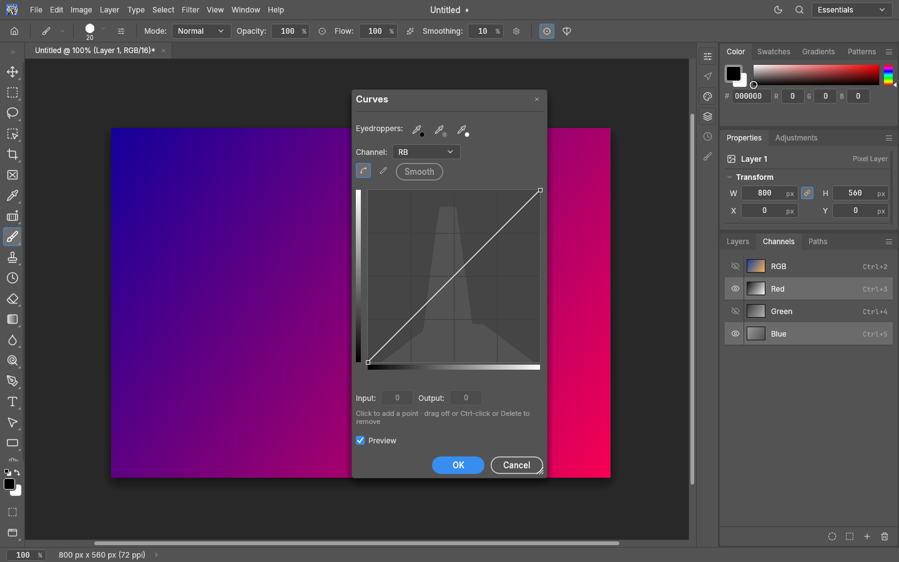
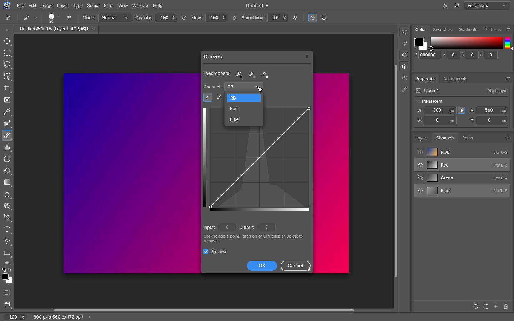
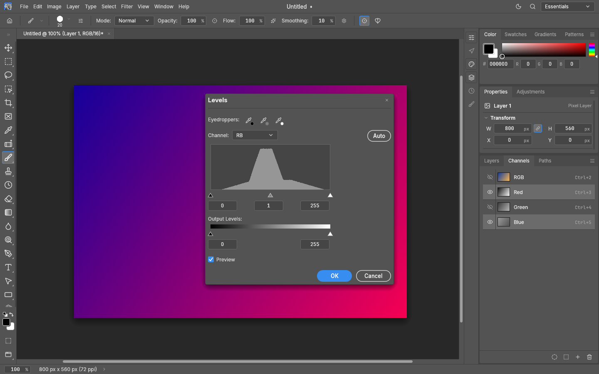
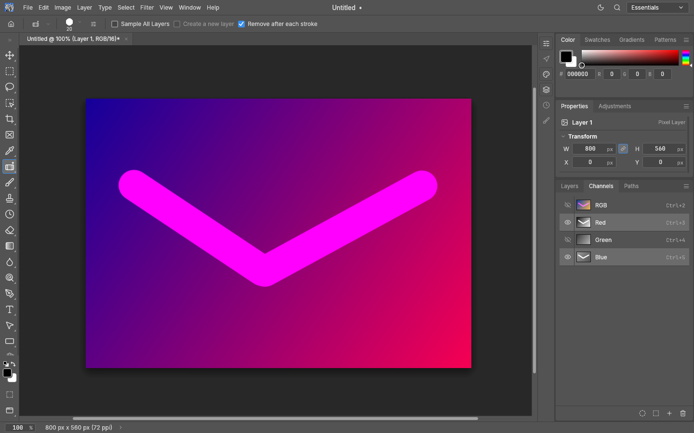
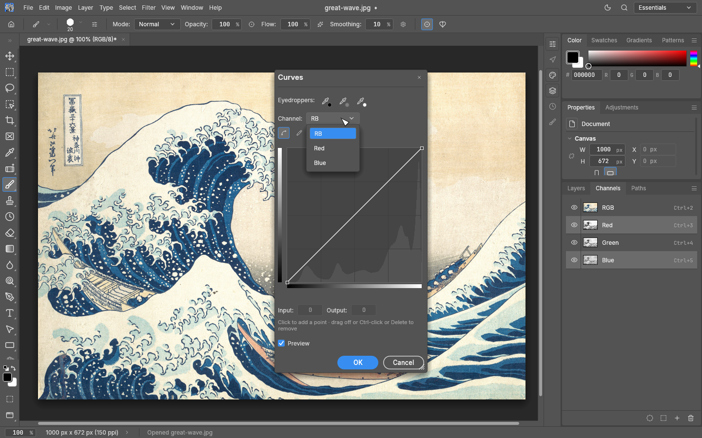
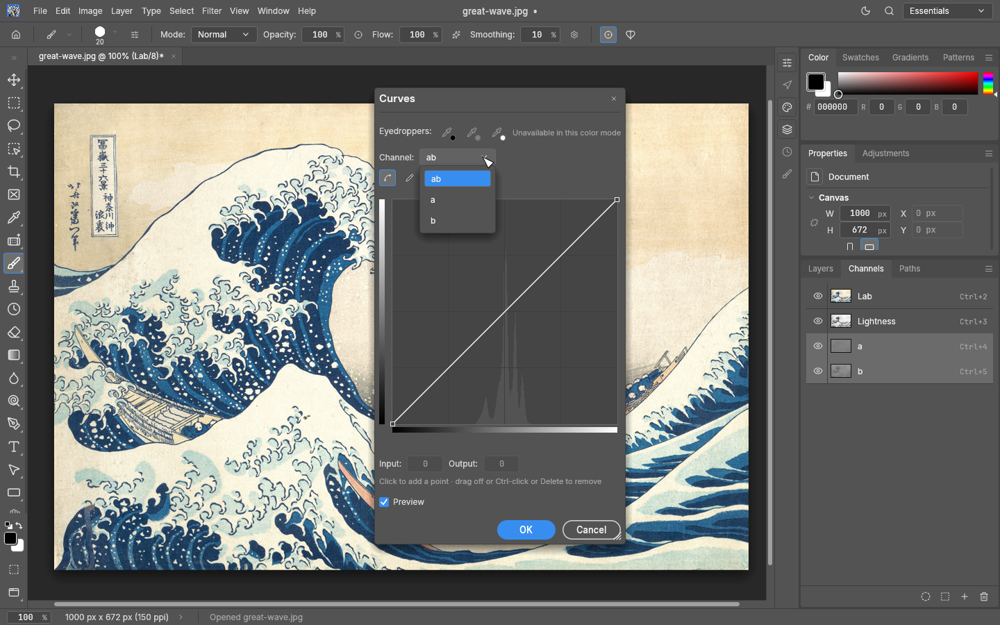

# Editing selected colour channels

Shift-click colour rows in the Channels panel to add or remove them from the editing
set. Only native colour channels can be combined. Selecting every colour channel
returns to the composite. Channel visibility can still be changed independently.

Partial sets work with the existing raster drawing tools (Brush, Pencil, erasers,
stamps, Mixer Brush, retouching tools, Bucket, Gradient and raster Fill/Stroke Path),
destructive adjustments, and the supported native raster filters. Erasing paints
the toolbox background colour into the selected components, preserving transparency.
Copy, Cut, Paste, Paste Into and Paste Outside carry the selected component planes.
Each committed operation records one undo step. Live drawing previews protect the
same components as the committed edit.

Levels and Curves show a neutral combined entry (for example **RB**) followed by the
selected individual components. Colour adjustments that mix components and filters
retain the original native layer context,
including transparency textures, depth inputs and colour-valued settings, and restore
unselected encoded samples. The combined tone operation is applied to each selected
native plane; individual settings can refine those planes. Histograms use
the selected layer's native component values. CMYK channels display tone (the inverse
of stored ink); Lab chroma uses the native neutral encoding at each depth.

RGB, CMYK and Lab are exercised at 8-bit, 16-bit and 32-bit float depths. Unselected
encoded samples, including transparency and float NaN payloads, are preserved byte
for byte. Active pixel selections, including feathering, still constrain editing.

Move and pixel transforms, including Content-Aware Scale and mesh warps, on partial
sets remain unavailable. Camera Raw requires
the composite or one colour channel. HDR Toning requires the composite because it flattens
the document. Filters that generate transparency cannot edit
colour-only targets. Options that create a new layer, including Remove’s Create a new layer option, also
require the composite.
Rasterize a non-raster layer before editing its colour planes.
Vector path transforms and moving guides remain available. This work is independent
of [#4648](https://github.com/storytold/photocraft/pull/4648) and
[#6864](https://github.com/storytold/photocraft/pull/6864); it does not include their
isolated-channel geometry or remaining scalar-target tone-dialog changes.

## Automation

The UI uses the existing engine commands. Native component indices follow the
document colour mode: RGB 0–2, CMYK 0–3 and Lab 0–2.

```json
{"command":"channel.target","params":{"colors":[0,2]}}
{"command":"channel.target","params":{"channel":{"color":1},"extend":true}}
{"command":"image.adjustments.curves","params":{"target":{"colors":[0,2]},"points":[[0,0],[128,170],[255,255]]}}
```

`extend` toggles a colour row; from the composite it toggles that row out of the full
set. Alpha channels, masks and Quick Mask cannot join a colour set. An explicit
`target` overrides the panel selection. Without it, applicable pixel commands follow
the selected set. The channels reply exposes `selectedColors` in addition to the
legacy primary `target`. Dialogs capture their target when opened; changing the panel
while a dialog is open does not redirect its operation.

## Validation and performance

`crates/engine/tests/multi_channel_editing.rs` covers the native mode/depth matrix,
selected-plane math, byte preservation, live/committed drawing, selections, clipboard,
explicit layer targets, HDR Curves, selected-default masks, missing destinations,
errors, undo and redo. UI tests cover the selected tone
choices, captured drawing targets and guide/path interaction.

The release benchmark is `crates/engine/examples/multi_channel_bench.rs`. It uses a
6000 × 4000 synthetic RGB16 raster, one warmup and six measured repetitions per case,
with target modes interleaved. Document setup is outside the timed interval; command
execution, pixel edits and history commit are inside. Eraser is the ordinary Brush
eraser. Live-update cases time one 50-pixel extension after stroke creation. Timings
exclude display refresh and do not claim end-to-end stylus latency.
The observed maximum of six samples is reported as p95 in the raw output.

Run with `RAYON_NUM_THREADS=8 cargo +1.99.0 run --release -p photocraft-engine
--example multi_channel_bench -- --subset`. For the unchanged base, use the same
fixture, parameters and timing loop and omit
`--subset`. The base cannot execute the new partial-set target. Add `--region` for the
five imaging cases through a 16 × 16 pixel selection; selection setup stays outside
the timer. Use `--clipboard` for a separate one-pixel paste case: copy and selection
setup stay outside the timer, while pasting edits the existing target layer.

Measured on 2026-10-25 on an AMD Ryzen 7 9700X (8 cores / 16 threads), Rust 1.99.0,
release profile with thin LTO and eight Rayon workers. The three target modes are
interleaved within each run. Retained runs had no concurrent Rust compilation or
engine/UI tests; a process watcher discarded any interrupted measurement.

The previous implementation at `15bf0873ba03622e54189e668df20a1403e41d56` was rerun
using its retained release binary (verified by SHA-256), with the same fixture,
parameters and timing loop. The original pre-feature baseline at
`6719f1813e84e96129fc31676cc945d51be0e736` is also retained in the raw data.

| Case (milliseconds) | All channels | Red only | Red + Blue | RB before fusion | RB maximum |
|---|---:|---:|---:|---:|---:|
| Invert | 75.23 | 21.78 | 26.37 | 126.81 | 28.98 |
| Threshold | 94.93 | 24.07 | 29.77 | 174.85 | 31.03 |
| Levels (gamma 1.4) | 102.88 | 23.44 | 29.06 | 218.91 | 29.52 |
| Curves (one midpoint) | 91.62 | 22.68 | 28.81 | 173.50 | 32.86 |
| Gaussian Blur (radius 8) | 184.71 | 320.05 | 288.82 | 298.25 | 293.23 |
| Brush commit (120 px) | 4.61 | 7.04 | 6.55 | 6.59 | 6.64 |
| Eraser commit (120 px) | 4.36 | 7.05 | 6.49 | 6.63 | 6.58 |
| Live brush (50 px extension) | 0.33 | 1.69 | 1.41 | 1.50 | 1.44 |
| Live eraser (50 px extension) | 0.30 | 1.70 | 1.41 | 1.49 | 1.42 |

Timings are p50 except the final column, which is the observed maximum of six samples
(the legacy raw field is named `p95_ms`). R+B tone edits take 1.21–1.27× Red-only
and are 4.8–7.5× faster than the rerun before fusion. The composite uses its existing
generic full-colour adjustment path and is an interleaved control.

Scalar adjustments visit native tiles once for the complete selected set, cloning each
destination tile once and writing only the selected components. Large integer edits prepare
exact sample-code tables through the existing adjustment math once per distinct channel
record; fully selected pixels use encoded lookups. Float and small-selection edits use bounded
tile buffers to retain HDR formulas and avoid full-image channel extraction. A test-only copy
of the previous scalar path checks the mode/depth/selection/default matrix byte for byte.
Filters retain the original native context and restore unselected encoded samples
after filtering. These runs establish no new performance budget or readiness percentage.

| Case, 16 × 16 selection | RB p50 (ms) | RB maximum (ms) |
|---|---:|---:|
| Invert | 0.98 | 1.08 |
| Threshold | 0.98 | 1.08 |
| Levels (gamma 1.4) | 1.61 | 2.08 |
| Curves (one midpoint) | 1.15 | 1.19 |
| Gaussian Blur (radius 8) | 0.92 | 0.99 |

The small-selection cases use the same 24 MP layer. They measure bounded region work,
including the filter halo, with selection creation outside the timer.

The separate one-pixel Paste case measured **0.46 ms** for one channel
and **1.00 ms** for RB. Copy and selection setup are outside the timer;
the paste edits the existing 24 MP layer. Destination extraction is bounded to the paste.

The complete harness peak RSS was 650.0 MiB after fusion and 674.3 MiB
before fusion. These are process peaks across all three target modes, not per-operation
allocation measurements.

Raw samples: [original pre-feature base](benchmarks/multi-channel-editing/baseline.json),
[before-fusion rerun](benchmarks/multi-channel-editing/before-fused-rerun.json),
[candidate](benchmarks/multi-channel-editing/candidate.json),
[small selection](benchmarks/multi-channel-editing/candidate-region.json),
[one-pixel paste](benchmarks/multi-channel-editing/candidate-clipboard.json),
[environment and binary hashes](benchmarks/multi-channel-editing/environment.json).
The three `candidate*-before-fused-original.json` files preserve the original feature run.

Validation: 6,471 engine and UI tests passed (38 ignored), including 53 focused engine
regressions. Strict all-target Clippy, formatting, layering,
wasm, parity generation and the adversarial command panic hunt passed. The complete
`cargo xtask perf --quick` runner was attempted: its layout fixture fails because
it tries to convert an already imported Smart Object. This unrelated runner failure is not
reported as a passing full performance gate. The feature-specific benchmark above
completed successfully. Eleven original review/fix rounds and three follow-up reviews were completed; the
latest review found no actionable issues. Visual captures were rendered offscreen
and inspected.


## Visual evidence

The images below use an original synthetic gradient, rendered offscreen without
opening a window. Their JSON scripts are adjacent to the images. Reproduce them with
`cargo run -p photocraft-ui-egui --example snapshot -- --safe-gpu --size 1440x900
--scale 1 --out <image.png> --script "$(cat <script.json>)"`; add `--click-at 720,242`
for the Curves dropdown capture.









### Public-domain image captures

These captures use Hokusai’s *The Great Wave off Kanagawa*, c. 1830–1832, a public-domain
work reproduced by the Metropolitan Museum and distributed through
[Wikimedia Commons](https://commons.wikimedia.org/wiki/File:Tsunami_by_hokusai_19th_century.jpg).
The unchanged source image, public-domain notice and scripts are adjacent to the captures.
All channels are visible so the artwork remains in full colour; the highlighted rows are
the editing set. The open Curves dropdown shows the neutral combined entry and only its
selected component choices.

Reproduce with the snapshot command above, adding `--open docs/images/multi-channel-editing/great-wave.jpg`
and using `rgb-script.json`, `cmyk-script.json` or `lab-script.json`. For the dropdown, add
`--click-at 700,243` for RGB or `--click-at 695,226` for CMYK/Lab.






### CodeRabbit findings

The initial review’s Last Filter non-object parameter panic and first single-channel live
retouch-preview restriction issues are fixed, with regression tests. The proposed extra CMYK
clipboard inversion is unnecessary: destination extraction and scatter already convert
between tone and ink. Tests cover implicit/explicit singleton copying into explicit targets
and normal/Paste Into/Paste Outside paths at 8/16/32-bit depths without adding an inversion.
